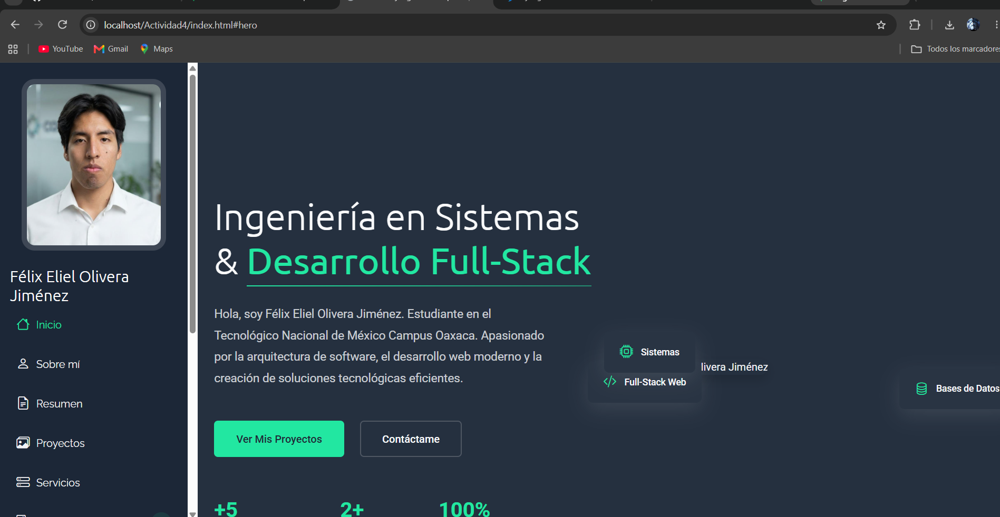
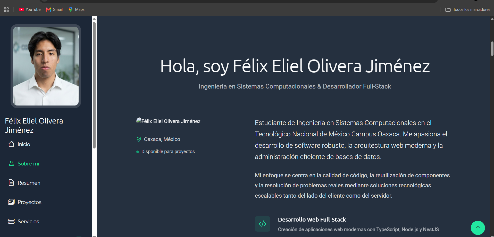
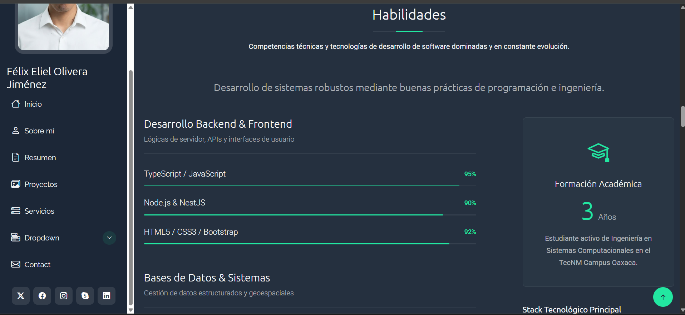
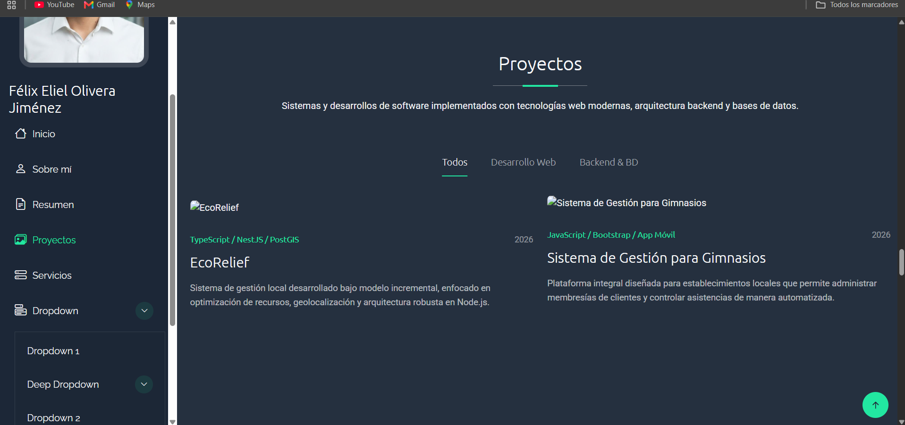

# Portafolio Profesional - Usando una plantilla de Bootstrap

## Descripción del Proyecto

Este proyecto consiste en un **portafolio profesional personal** diseñado para exhibir de manera limpia y responsiva la perfilación académica, habilidades técnicas y proyectos de desarrollo de software.

* **Plantilla base utilizada:** Se descargó y adaptó la plantilla [MyPage de BootstrapMade](https://bootstrapmade.com/mypage-bootstrap-personal-template/), basada en **Bootstrap 5**, orientada a portafolios personales de una sola página (*Single Page Application*).
* **Secciones que componen el Portafolio:**
  1. **Inicio / Hero Section:** Cabecera de alto impacto visual con fotografía de perfil profesional real, título del rol (Ingeniería en Sistemas & Desarrollador Full-Stack) y botones de llamada a la acción.
  2. **Sobre Mí (About):** Resumen de la trayectoria académica como estudiante de ingeniería en sistemas computacionales en el TecNM Campus Oaxaca y enfoque en desarrollo y bases de datos.
  3. **Estadísticas (Stats):** Datos clave y logros del perfil académico.
  4. **Currículum (Resume):** Línea de tiempo de proyectos recientes (*EcoRelief*, sistema de gimnasios) y formación superior.
  5. **Servicios (Services):** Oferta de soluciones en desarrollo Full-Stack, bases de datos y contenedores.
  6. **Habilidades (Skills):** Cuadrícula y barras de progreso divididas por categorías técnicas (TypeScript, NestJS, PostgreSQL, Docker, etc.).
  7. **Proyectos Destacados (Portfolio):** Tarjetas interactivas con descripciones de software desarrollado y tecnologías correspondientes.
  8. **Contacto (Contact):** Sección interactiva con canales de comunicación directa y formulario de contacto.

---

## Proceso de Creación (Paso a Paso)

El portafolio fue construido y adaptado siguiendo estas etapas:

1. **Descarga y Estructuración:** Se descargó la plantilla oficial desde [BootstrapMade](https://bootstrapmade.com/mypage-bootstrap-personal-template/), organizando los archivos estáticos en las carpetas correspondientes (`/assets`, `/css`, `/js`, `/img`).
2. **Eliminación y Limpieza de Archivos:** Se depuraron los archivos temporales y textos predeterminados de la plantilla para unificar la estructura del repositorio.
3. **Personalización del Código (`index.html`):** 
   * Se modificaron los textos en inglés de todas las secciones (*Hero*, *About*, *Stats*, *Resume*, *Services*, *Skills*, *Portfolio*, *Contact*) para reflejar la identidad y perfil profesional real en el TecNM Campus Oaxaca.
   * Se incorporó una fotografía de perfil real en la cabecera y en la sección *About*.
   * Se actualizaron los enlaces y descripciones de los proyectos académicos (*EcoRelief* y el sistema de gestión para gimnasios).
4. **Pruebas y Despliegue:** Se validó el comportamiento responsivo en el navegador localmente y se configuró el repositorio para su publicación en vivo mediante **GitHub Pages**.

---

## 📸 Capturas de Pantalla

**Vista General del Portafolio:**

**Secciones de Habilidades (Skills) y Proyectos:**

